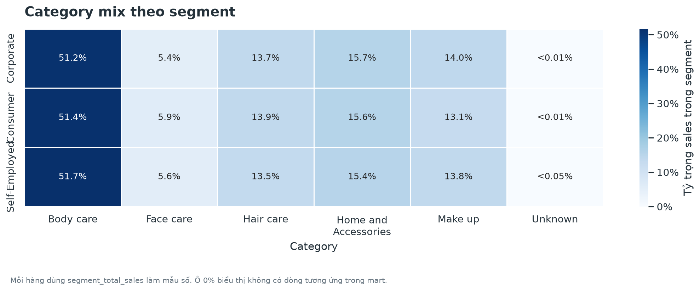
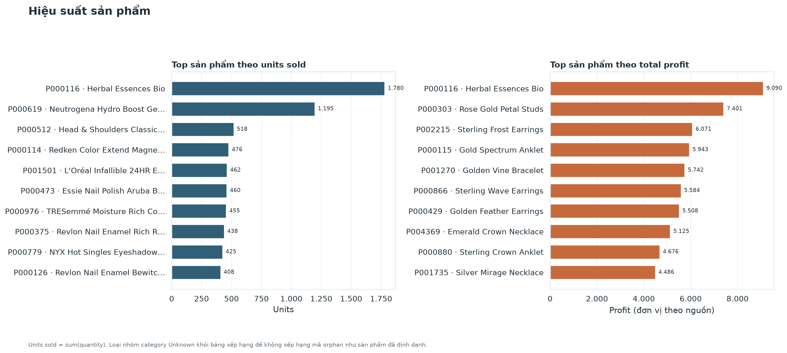
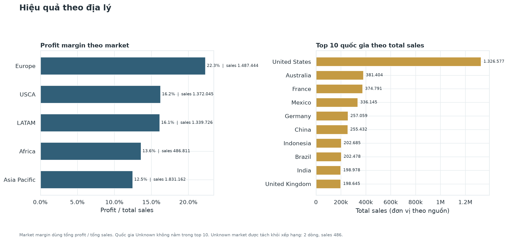
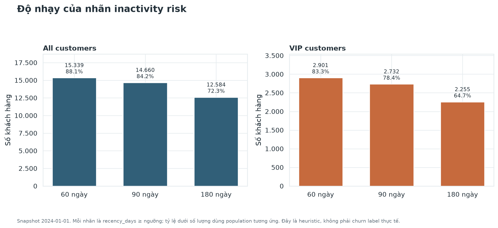
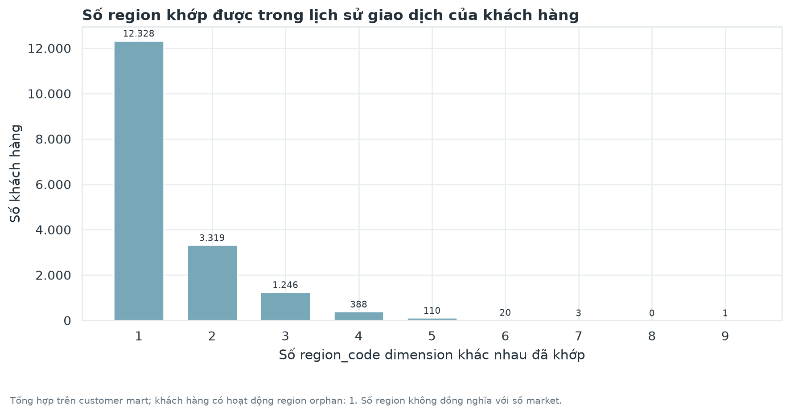
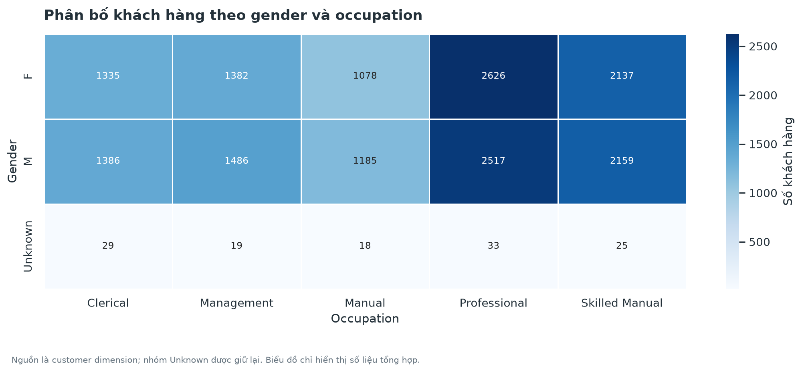
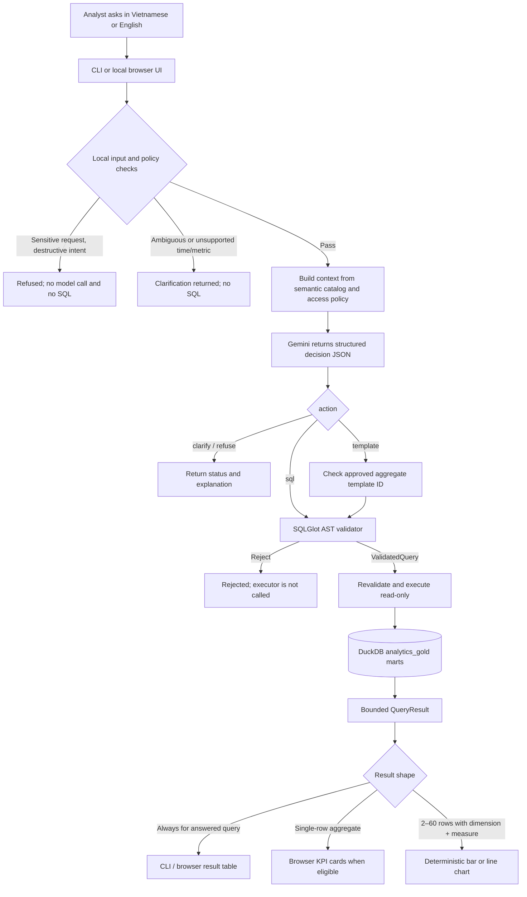

# E-commerce Analytics & Governed Text-to-SQL

An end-to-end analytics project for turning e-commerce transactions into tested business marts, reproducible charts, and governed natural-language analytics.

The batch data path is **SQL Server → DLT → DuckDB → dbt**. Apache Airflow with Astronomer Cosmos coordinates ingestion, transformations, and quality checks. A separate Text-to-SQL service answers questions from approved Gold marts.

## System architecture

Airflow controls the **batch refresh path**. The Text-to-SQL application is a separate **serving path**: it queries Gold read-only and is not run as part of the Airflow DAG.

## What the project delivers

- Snapshot ingestion from four SQL Server source tables with source-to-warehouse row-count reconciliation.
- A DuckDB warehouse organized into Bronze, Silver, Intermediate, and Gold layers.
- Twelve dbt Gold marts for sales, discounts, customers, products, and geography, with model-level tests and reconciliation checks.
- Ten reproducible static charts generated from Gold marts.
- Vietnamese and English Text-to-SQL routing with a semantic catalog, access policy, SQLGlot validation, and a read-only DuckDB executor.
- A local browser UI that returns result tables and KPI cards, and draws a chart when the query result has a suitable shape.
- An optional manual Airflow/Cosmos workflow and GitHub Actions checks.

## Pipeline components

| Component | Technology | Responsibility |
|---|---|---|
| Source | SQL Server | Transactional source relations: <code>customer</code>, <code>ecom_sales</code>, <code>product</code>, and <code>region</code>. |
| Ingestion | DLT | Reads the source snapshot, loads the Bronze layer in DuckDB, and reconciles row counts. |
| Warehouse | DuckDB | Local analytical warehouse. The same warehouse file is shared by dbt, charts, and Text-to-SQL. |
| Transformation | dbt-duckdb | Builds typed staging views, enriched sales, Gold marts, and data-quality tests. |
| Orchestration | Apache Airflow + Astronomer Cosmos | Coordinates preflight, DLT, Cosmos-rendered dbt models/tests, and the offline quality gate. |
| Serving | Python, Gemini API (optional), SQLGlot | Routes questions, applies semantic and access policy, validates SQL, executes approved queries, and formats results. |
| Visualization | Python | Generates ten static charts from Gold, independently of the Text-to-SQL UI charts. |

## Warehouse and analytical outputs

### Gold marts

| Area | Models |
|---|---|
| Sales | <code>mart_sales_by_segment</code>, <code>mart_discount_profitability</code>, <code>mart_loss_making_orders_by_segment</code>, <code>mart_monthly_sales</code> |
| Products | <code>mart_product_performance</code>, <code>mart_category_sales_mix_by_segment</code>, <code>mart_market_basket_associations</code> |
| Customers | <code>mart_customer_rfm</code>, <code>mart_customer_profile_by_gender_occupation</code>, <code>mart_customer_region_behavior</code> |
| Geography | <code>mart_profitability_by_market</code>, <code>mart_top_countries_by_sales</code> |

## Business Analytics Query Results (Real Data Output)

These outputs are from the reconciled 2020–2023 source snapshot, not sample or generated data. The 15 baseline questions compare the Gold marts with the project’s recorded business definitions; the full question-by-question results and caveats are in [Business Analytics Query Results](docs/business-analytics-results.md) and [warehouse reconciliation evidence](reports/warehouse-reconciliation.md).

Amounts retain source units. The source currency and whether <code>sales</code> is gross or net have not been confirmed, so no currency symbol is shown. RFM values use the historical snapshot date <code>2024-01-01</code>.

### Overall performance

| Sales lines | Orders | Total sales | Total profit | Profit margin |
|---:|---:|---:|---:|---:|
| 51,290 | 25,728 | 6,517,674.00 | 1,065,413.58 | 16.35% |

### Segment profitability

| Segment | Sales lines | Orders | Total sales | Total profit | Profit margin |
|---|---:|---:|---:|---:|---:|
| Corporate | 15,429 | 7,724 | 3,840,707.00 | 608,523.36 | 15.84% |
| Consumer | 26,518 | 13,291 | 2,146,780.00 | 365,377.50 | 17.02% |
| Self-Employed | 9,343 | 4,713 | 530,187.00 | 91,512.72 | 17.26% |

Corporate contributes the most sales and profit, while Self-Employed has the highest margin on the smallest sales base. Margin alone does not determine where to invest; product mix, discounting, and incremental contribution should be examined before changing commercial policy.

### Discount and order-loss signal

| Discount band | Sales lines | Loss-making line rate | Total profit |
|---|---:|---:|---:|
| 0% | 29,470 | 0.00% | 1,141,917.51 |
| (0%, 20%] | 10,533 | 26.08% | 211,677.68 |
| (20%, 40%] | 4,430 | 52.05% | -51,387.30 |
| (40%, 60%] | 4,736 | 81.65% | -146,576.11 |
| >60% | 2,121 | 100.00% | -90,218.20 |

The higher-discount bands have negative aggregate profit and higher loss-line rates in this snapshot. This is an observational relationship, not evidence that discount caused the losses. An order is classified as loss-making only when the sum of its line profits is below zero.

### Customer and product highlights

| Analysis | Snapshot result | How to read it |
|---|---|---|
| VIP / inactivity risk | 3,483 VIP customers; at a 90-day threshold, 14,660 customers are flagged, including 2,732 VIPs. | Recency-based historical heuristic, not a churn label or current customer status. |
| Best-selling product | P000116, 1,780 units and 67,640 total sales. | “Best-selling” means units sold; source product taxonomy is retained as provided. |
| Basket associations | No product pair meets the default 0.5% support threshold; the most frequent pair appears in 3 orders. | Too sparse to support a cross-sell recommendation at the configured threshold. |

## Executive Dashboards & Gold Visualizations

The ten charts below are reproducible aggregate views of the Gold marts. Each visual answers a business question and links to the full-size PNG. Run <code>uv run --project . python scripts/project.py charts</code> after a successful ingestion and dbt build to regenerate them. For the source questions, metric definitions, and interpretation notes, see the [chart index](docs/assets/charts/README.md).

<table>
  <tr>
    <td width="50%"><strong>1. Executive overview</strong> What are the headline sales, profit, margin, order, and customer measures?</td>
    <td width="50%"><strong>2. Discount profitability</strong> How do profit and loss-making line rates vary across discount bands?</td>
  </tr>
  <tr>
    <td><strong>3. Segment profitability</strong> How do sales, profit, and margin compare by customer segment?</td>
    <td><strong>4. Monthly performance</strong> How do sales and profit change over time, and how does sales compare with the prior year?</td>
  </tr>
  <tr>
    <td><strong>5. Category mix by segment</strong> How is each segment’s sales distributed among categories?</td>
    <td><strong>6. Product performance</strong> Which products lead by units sold and by profit?</td>
  </tr>
  <tr>
    <td><strong>7. Geography performance</strong> How do markets compare on margin, and which countries lead by sales?</td>
    <td><strong>8. RFM risk sensitivity</strong> How sensitive are inactivity-risk counts to 60-, 90-, and 180-day thresholds?</td>
  </tr>
  <tr>
    <td><strong>9. Customer region behavior</strong> How many customers have sales across multiple matched regions?</td>
    <td><strong>10. Customer profile</strong> How is the customer population distributed by gender and occupation?</td>
  </tr>
</table>

These charts summarize the available snapshot; they do not establish causality. In particular, the discount and RFM charts should be read with the [data contract](docs/data-contract.md) and the caveats in the [business insights](docs/business-insights.md).

## Repository structure

    .
    ├── .github/workflows/        # Offline/dbt CI and Astro DAG contract CI
    ├── analytics/visualization/  # Static chart queries and chart generation
    ├── docs/
    │   ├── assets/               # System diagram and generated charts
    │   └── decisions/            # Architecture decisions
    ├── ecom_analytics/           # dbt sources, staging, intermediate, marts, and tests
    ├── ingestion/                # SQL Server connectivity and DLT pipeline
    ├── orchestration/            # Astro Runtime, Airflow DAG, and DAG tests
    ├── reports/                  # Sanitized evaluation and runtime evidence
    ├── scripts/                  # Repository-aware command wrapper
    ├── sql/                      # Read-only source profiling query
    ├── tests/                    # Python unit and contract tests
    ├── text2sql/                 # Semantic catalog, policy, routing, validation, and serving
    └── duckdb_warehouse/         # Local DuckDB file; ignored by Git

The warehouse, credentials, local profiles, logs, caches, and generated Astro runtime staging are machine-local artifacts and are not committed.

## Quick start

### Requirements

- Windows PowerShell or Linux shell
- Python 3.11
- [uv](https://docs.astral.sh/uv/)
- Network access and read permission to the configured SQL Server source for ingestion

### 1. Install and configure

Clone the repository, install the locked dependencies, and create a local environment file from the safe template:

    git clone https://github.com/Nguyen-Hoan023/ecom-analytics-text2sql.git
    Set-Location ecom-analytics-text2sql
    uv sync --locked

    if (-not (Test-Path .env)) {
        Copy-Item -LiteralPath .env.example -Destination .env
    }
    notepad .env

Set the <code>SOURCE_SQLSERVER_HOST</code>, <code>SOURCE_SQLSERVER_PORT</code>, <code>SOURCE_SQLSERVER_DATABASE</code>, <code>SOURCE_SQLSERVER_SCHEMA</code>, <code>SOURCE_SQLSERVER_USERNAME</code>, and <code>SOURCE_SQLSERVER_PASSWORD</code> values in your local <code>.env</code>. Keep the file and its credentials out of Git. <code>DUCKDB_PATH</code> is optional; by default the warehouse is <code>duckdb_warehouse/warehouse.duckdb</code>.

### 2. Load and build the warehouse

Run commands from the repository root:

    uv run --project . python -m ingestion.check_source_connection
    uv run --project . python -m ingestion.run_pipeline
    uv run --project . python scripts/project.py dbt build
    uv run --project . python -m text2sql.evaluation.run_baselines

The source check is read-only. The DLT pipeline loads the current snapshot; dbt builds and tests the models. The baseline suite checks 15 approved analytical cases against the local warehouse and does not call Gemini.

### 3. Generate charts or ask a question

Generate the ten static charts:

    uv run --project . python scripts/project.py charts

Start the local browser interface:

    uv run --project . python scripts/project.py ui

Open <http://127.0.0.1:8765>. The UI listens locally; do not expose it to the public internet. For a one-off CLI question:

    uv run --project . python -m text2sql.cli "Show total sales and profit by segment"

For questions that need live model generation, configure <code>GEMINI_API_KEY</code> in the local root <code>.env</code>. <code>GEMINI_MODEL</code> can select the configured model. Offline guardrails and baseline checks do not require the key.

## Text-to-SQL (T2S) Natural Language Query Engine

The T2S service lets an analyst ask questions in Vietnamese or English and receive a query result without writing SQL. It serves the already-built **Gold marts**; it does not ingest or transform data, and it runs separately from the Airflow refresh DAG. The design follows the reference project's component-by-component T2S walkthrough, with this project's semantic catalog, approved aggregate templates, SQLGlot policy boundary, and web result rendering documented explicitly. ([Reference repository](https://github.com/tunguyenn99/a-simple-t2s-flow))

### Request flow

The model is a **query planner**, not a database client. Gemini receives the question and approved semantic metadata; the warehouse, query results, credentials, customer rows, and DuckDB file path remain local. The server-side service decides whether the model's decision can proceed.

### What happens at each step

| Step | Component | What it does |
|---:|---|---|
| 1 | Input interfaces — [`cli.py`](text2sql/cli.py), [`web_app.py`](text2sql/web_app.py) | Accept a bounded question in Vietnamese or English. The browser app runs locally and shows the returned status, answer, validated SQL when applicable, and result. |
| 2 | Local router — [`nl_service.py`](text2sql/nl_service.py) | Checks length and screens for personal/customer-level requests, destructive intent, current-period requests outside the 2020–2023 snapshot, ambiguous profitability wording, and causal discount claims. It can refuse or ask for clarification before making an API call. |
| 3 | Semantic context — [`catalog.py`](text2sql/catalog.py), [`semantic_catalog.yml`](text2sql/semantic_catalog.yml), [`access_policy.yml`](text2sql/access_policy.yml) | Supplies Gemini with approved Gold relations, grain, exposed columns, metric meanings, synonyms, caveats, language guidance, and limits. Context is built for the trusted local role; the role is never taken from the user prompt. |
| 4 | Structured generation — [`gemini.py`](text2sql/gemini.py) | If local checks pass, asks the configured Gemini model for one structured decision: `sql`, `template`, `clarify`, or `refuse`. JSON schema, low temperature, and output limits constrain the response format. A missing key, quota/provider error, or invalid model response fails closed; no fallback query is executed. |
| 5 | Restricted-data branch — [`service.py`](text2sql/service.py) | For the customer-level RFM and region marts, accepts only an approved template ID (Q08, Q13, or Q14). The SQL body stays in local policy, is checked for the trusted role, and must match the approved template exactly after normalization. |
| 6 | SQL authorization — [`validator.py`](text2sql/validator.py) | Parses the SQL as DuckDB with SQLGlot and returns a `ValidatedQuery` only if it is exactly one `SELECT` over one fully qualified, allowlisted Gold mart. It checks AST node types, relation, column, function, output, and row-limit rules. |
| 7 | Query execution — [`executor.py`](text2sql/executor.py) | Accepts only `ValidatedQuery`, validates it again, then opens DuckDB with `read_only=True`. External access and extension loading are disabled and configuration is locked. Policy sets a 10-second runtime, two threads, 1 GB memory and temp limits, and a 500-row hard cap. |
| 8 | Result rendering — [`output.py`](text2sql/output.py), [`charting.py`](text2sql/charting.py), [`web_app.py`](text2sql/web_app.py) | Returns a bounded table. The browser can display KPI cards for eligible one-row results and suggests a line chart for date dimensions or a bar chart for other compatible results. Charts use only returned rows; they do not run SQL or calculate new aggregates. The CLI supports table/JSON output and non-overwriting CSV export. |

### Policy boundary

- Direct model-generated queries can read only approved aggregate/product-level marts in `analytics_gold`. Bronze, Silver, Intermediate, source tables, and unlisted relations are outside the serving allowlist.
- Only one `SELECT` statement is accepted. Joins, CTEs, subqueries, `SELECT *`, table functions, external file/network access, unapproved columns/functions, and destructive statements are rejected before execution.
- Customer-level RFM and region marts are restricted to their three approved aggregate templates. Customer identifiers and individual RFM values are not available to the general query role.
- Demographic results must retain groups with at least 10 customers. The result row cap, runtime, memory, and thread limits are enforced separately by the validator and executor.
- The local browser UI is single-user and has no authentication. Keep it on localhost; a shared deployment needs identity, authorization, and process/container isolation before it is exposed to other users.

### What users see

| Service status | Meaning |
|---|---|
| `answered` | The validated query ran and a bounded result is available. |
| `clarify` | The time period, metric, or supported interpretation needs clarification; no query ran. |
| `refused` | The request conflicts with the access or read-only policy; no query ran. |
| `rejected` | The model's SQL or template did not satisfy the current catalog/policy; no query ran. |
| `unavailable` | Gemini is unconfigured, unavailable, or returned an unusable decision; no SQL ran. |
| `failed` | A validated query or approved template could not be executed by the warehouse. |

The browser's query-result chart is different from the ten static Gold charts above: static charts are generated from predefined marts, while T2S charts visualize only the rows returned for the current question. See the [Text-to-SQL module guide](text2sql/README.md) and [evaluation guide](text2sql/evaluation/README.md) for setup, guardrail cases, and baseline commands.

## Optional Airflow / Cosmos workflow

Airflow is useful when the batch refresh needs observable task states, retries, logs, and an end-to-end quality gate. It is optional for local dbt, chart generation, and Text-to-SQL development.

The manual DAG is <code>ecommerce_warehouse_refresh</code>:

    preflight → DLT snapshot ingestion → Cosmos dbt models and tests → offline baseline quality gate

To run it locally, use Docker Desktop with the Linux engine and Astro CLI. Create a container-specific environment file and set the same <code>SOURCE_SQLSERVER_*</code> variables there. Set <code>DUCKDB_PATH=/usr/local/airflow/duckdb_warehouse/warehouse.duckdb</code> for the Linux container path. The DAG does not need the Gemini API key.

    if (-not (Test-Path orchestration/.env)) {
        Copy-Item -LiteralPath orchestration/.env.example -Destination orchestration/.env
    }
    notepad orchestration/.env

Then prepare the runtime and parse, test, and start Airflow:

    uv run --project . python scripts/project.py astro prepare
    Set-Location orchestration
    astro dev parse
    astro dev pytest tests/dags
    astro dev start

Open <http://localhost:8080> and trigger <code>ecommerce_warehouse_refresh</code> manually. The DAG has no recurring schedule configured. Stop the local stack with <code>astro dev stop</code>. Do not run another process that writes to the same DuckDB file while the DAG is refreshing it.

## Quality checks

Offline checks do not need SQL Server, a warehouse, or Gemini:

    uv run --project . python scripts/project.py offline-checks
    uv run --project . python scripts/project.py dbt parse

After ingestion and dbt build, run the 15-case baseline suite as shown above. The GitHub Actions workflows run offline/dbt validation and Astro DAG contract checks. A passing <code>dbt parse</code> validates the project graph; it does not prove that source connectivity or a warehouse refresh succeeded.

## Data interpretation and scope

- The current transaction snapshot covers dates from 2020 through 2023; the RFM snapshot date is <code>2024-01-01</code>.
- RFM inactivity risk is a heuristic based on recency, not a labeled churn prediction.
- Unmatched product and region keys are retained in the enriched data so sales are not silently dropped.
- Discount comparisons are observational and should not be described as causal effects.
- Monetary values preserve source units until currency and gross/net semantics are confirmed.
- The market-basket mart is exploratory; sparse product-pair counts limit recommendation claims.

## Project documentation

- [Documentation index](docs/README.md) · [Ingestion guide](ingestion/README.md) · [dbt guide](ecom_analytics/README.md) · [Text-to-SQL guide](text2sql/README.md)
- [Visualization guide](analytics/README.md) · [Orchestration guide](orchestration/README.md) · [CI workflows](.github/workflows/README.md)
- [Python tests](tests/README.md) · [dbt model tests](ecom_analytics/tests/README.md) · [DAG contract tests](orchestration/tests/README.md) · [Evidence index](reports/README.md)
- [System architecture and runtime boundaries](docs/architecture.md)
- [dbt project configuration](ecom_analytics/dbt_project.yml) and [dbt models](ecom_analytics/models/)
- [DLT ingestion entrypoint](ingestion/run_pipeline.py)
- [Airflow/Cosmos DAG](orchestration/dags/ecommerce_warehouse_refresh.py) and [DAG contract tests](orchestration/tests/dags/)
- [Text-to-SQL access policy](text2sql/access_policy.yml)
- [Semantic catalog](text2sql/semantic_catalog.yml)
- [Golden analytical and guardrail cases](text2sql/evaluation/golden_set_v1.yml)
- [Static chart generator](analytics/visualization/generate_charts.py) and [chart outputs](docs/assets/charts/)
- [Data contract and metric assumptions](docs/data-contract.md)
- [Business insights and caveats](docs/business-insights.md)
- [Q1–Q15 warehouse reconciliation evidence](reports/warehouse-reconciliation.md)
