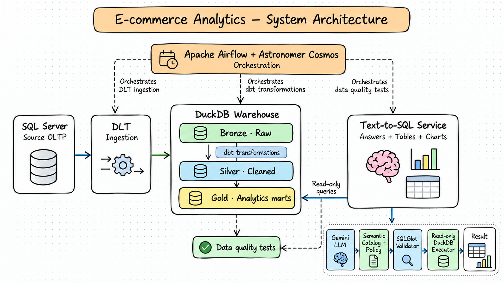

# E-commerce Analytics & Governed Text-to-SQL

An end-to-end analytics project for turning e-commerce transactions into tested business marts, reproducible charts, and governed natural-language analytics.

The batch data path is **SQL Server → DLT → DuckDB → dbt**. Apache Airflow with Astronomer Cosmos coordinates ingestion, transformations, and quality checks. A separate Text-to-SQL service answers questions from approved Gold marts.

## System architecture

Airflow controls the **batch refresh path**. The Text-to-SQL application is a separate **serving path**: it queries Gold read-only and is not run as part of the Airflow DAG.

## What the project delivers

- Snapshot ingestion from four SQL Server source tables with source-to-warehouse row-count reconciliation.
- A DuckDB warehouse organized into Bronze, Silver, Intermediate, and Gold layers.
- Twelve dbt Gold marts for sales, discounts, customers, products, and geography, with model-level tests and reconciliation checks.
- Ten reproducible static charts generated from Gold marts.
- Vietnamese and English Text-to-SQL routing with a semantic catalog, access policy, SQLGlot validation, and a read-only DuckDB executor.
- A local browser UI that returns result tables and KPI cards, and draws a chart when the query result has a suitable shape.
- An optional manual Airflow/Cosmos workflow and GitHub Actions checks.

## Pipeline components

| Component | Technology | Responsibility |
|---|---|---|
| Source | SQL Server | Transactional source relations: <code>customer</code>, <code>ecom_sales</code>, <code>product</code>, and <code>region</code>. |
| Ingestion | DLT | Reads the source snapshot, loads the Bronze layer in DuckDB, and reconciles row counts. |
| Warehouse | DuckDB | Local analytical warehouse. The same warehouse file is shared by dbt, charts, and Text-to-SQL. |
| Transformation | dbt-duckdb | Builds typed staging views, enriched sales, Gold marts, and data-quality tests. |
| Orchestration | Apache Airflow + Astronomer Cosmos | Coordinates preflight, DLT, Cosmos-rendered dbt models/tests, and the offline quality gate. |
| Serving | Python, Gemini API (optional), SQLGlot | Routes questions, applies semantic and access policy, validates SQL, executes approved queries, and formats results. |
| Visualization | Python | Generates ten static charts from Gold, independently of the Text-to-SQL UI charts. |

## Warehouse and analytical outputs

### Gold marts

| Area | Models |
|---|---|
| Sales | <code>mart_sales_by_segment</code>, <code>mart_discount_profitability</code>, <code>mart_loss_making_orders_by_segment</code>, <code>mart_monthly_sales</code> |
| Products | <code>mart_product_performance</code>, <code>mart_category_sales_mix_by_segment</code>, <code>mart_market_basket_associations</code> |
| Customers | <code>mart_customer_rfm</code>, <code>mart_customer_profile_by_gender_occupation</code>, <code>mart_customer_region_behavior</code> |
| Geography | <code>mart_profitability_by_market</code>, <code>mart_top_countries_by_sales</code> |

### Example findings from the 2020–2023 snapshot

The following values are illustrative outputs from the current local source snapshot. <code>total_sales</code> and <code>total_profit</code> retain source units; the source currency and whether sales are gross or net have not been confirmed.

| Segment | Sales | Profit | Profit margin |
|---|---:|---:|---:|
| Corporate | 3,840,707.00 | 608,523.36 | 15.8% |
| Consumer | 2,146,780.00 | 365,377.50 | 17.0% |
| Self-Employed | 530,187.00 | 91,512.72 | 17.3% |
| **Overall** | **6,517,674.00** | **1,065,413.58** | **16.3%** |

Discount analysis shows a pattern to investigate: the 0% and 0–20% bands have positive aggregate profit, while bands above 20% have negative aggregate profit in this snapshot. The share of loss-making sales lines also rises across higher discount bands. These are descriptive associations; they do not establish that discounts caused the losses.

### Static chart samples

  
  
  

The full set of ten generated charts is in [docs/assets/charts/](docs/assets/charts/). Rebuild them with the <code>charts</code> command below.

## Repository structure

    .
    ├── .github/workflows/        # Offline/dbt CI and Astro DAG contract CI
    ├── analytics/visualization/  # Static chart queries and chart generation
    ├── docs/
    │   ├── assets/               # System diagram and generated charts
    │   └── decisions/            # Architecture decisions
    ├── ecom_analytics/           # dbt sources, staging, intermediate, marts, and tests
    ├── ingestion/                # SQL Server connectivity and DLT pipeline
    ├── orchestration/            # Astro Runtime, Airflow DAG, and DAG tests
    ├── reports/                  # Sanitized evaluation and runtime evidence
    ├── scripts/                  # Repository-aware command wrapper
    ├── sql/                      # Read-only source profiling query
    ├── tests/                    # Python unit and contract tests
    ├── text2sql/                 # Semantic catalog, policy, routing, validation, and serving
    └── duckdb_warehouse/         # Local DuckDB file; ignored by Git

The warehouse, credentials, local profiles, logs, caches, and generated Astro runtime staging are machine-local artifacts and are not committed.

## Quick start

### Requirements

- Windows PowerShell or Linux shell
- Python 3.11
- [uv](https://docs.astral.sh/uv/)
- Network access and read permission to the configured SQL Server source for ingestion

### 1. Install and configure

Clone the repository, install the locked dependencies, and create a local environment file from the safe template:

    git clone https://github.com/Nguyen-Hoan023/ecom-analytics-text2sql.git
    Set-Location ecom-analytics-text2sql
    uv sync --locked

    if (-not (Test-Path .env)) {
        Copy-Item -LiteralPath .env.example -Destination .env
    }
    notepad .env

Set the <code>SOURCE_SQLSERVER_HOST</code>, <code>SOURCE_SQLSERVER_PORT</code>, <code>SOURCE_SQLSERVER_DATABASE</code>, <code>SOURCE_SQLSERVER_SCHEMA</code>, <code>SOURCE_SQLSERVER_USERNAME</code>, and <code>SOURCE_SQLSERVER_PASSWORD</code> values in your local <code>.env</code>. Keep the file and its credentials out of Git. <code>DUCKDB_PATH</code> is optional; by default the warehouse is <code>duckdb_warehouse/warehouse.duckdb</code>.

### 2. Load and build the warehouse

Run commands from the repository root:

    uv run --project . python -m ingestion.check_source_connection
    uv run --project . python -m ingestion.run_pipeline
    uv run --project . python scripts/project.py dbt build
    uv run --project . python -m text2sql.evaluation.run_baselines

The source check is read-only. The DLT pipeline loads the current snapshot; dbt builds and tests the models. The baseline suite checks 15 approved analytical cases against the local warehouse and does not call Gemini.

### 3. Generate charts or ask a question

Generate the ten static charts:

    uv run --project . python scripts/project.py charts

Start the local browser interface:

    uv run --project . python scripts/project.py ui

Open <http://127.0.0.1:8765>. The UI listens locally; do not expose it to the public internet. For a one-off CLI question:

    uv run --project . python -m text2sql.cli "Show total sales and profit by segment"

For questions that need live model generation, configure <code>GEMINI_API_KEY</code> in the local root <code>.env</code>. <code>GEMINI_MODEL</code> can select the configured model. Offline guardrails and baseline checks do not require the key.

## Text-to-SQL safety

The model proposes SQL; application code decides whether that SQL may run.

1. The question is matched against local routing and the semantic catalog supplies approved Gold marts and metric definitions.
2. When needed, the configured Gemini model proposes a query.
3. SQLGlot parses and validates the statement against the SQL dialect, allowed relations, and query policy.
4. The executor accepts only a validated query and opens DuckDB read-only with configured row and execution limits.
5. Results are returned as a bounded table; the UI can add KPI cards and an appropriate chart.

Destructive statements and relations outside the approved catalog are rejected before execution. Customer-level data access is restricted by policy and approved aggregate templates. Never place credentials, sensitive customer information, or raw source records in prompts.

## Optional Airflow / Cosmos workflow

Airflow is useful when the batch refresh needs observable task states, retries, logs, and an end-to-end quality gate. It is optional for local dbt, chart generation, and Text-to-SQL development.

The manual DAG is <code>ecommerce_warehouse_refresh</code>:

    preflight → DLT snapshot ingestion → Cosmos dbt models and tests → offline baseline quality gate

To run it locally, use Docker Desktop with the Linux engine and Astro CLI. Create a container-specific environment file and set the same <code>SOURCE_SQLSERVER_*</code> variables there. Set <code>DUCKDB_PATH=/usr/local/airflow/duckdb_warehouse/warehouse.duckdb</code> for the Linux container path. The DAG does not need the Gemini API key.

    if (-not (Test-Path orchestration/.env)) {
        Copy-Item -LiteralPath orchestration/.env.example -Destination orchestration/.env
    }
    notepad orchestration/.env

Then prepare the runtime and parse, test, and start Airflow:

    uv run --project . python scripts/project.py astro prepare
    Set-Location orchestration
    astro dev parse
    astro dev pytest tests/dags
    astro dev start

Open <http://localhost:8080> and trigger <code>ecommerce_warehouse_refresh</code> manually. The DAG has no recurring schedule configured. Stop the local stack with <code>astro dev stop</code>. Do not run another process that writes to the same DuckDB file while the DAG is refreshing it.

## Quality checks

Offline checks do not need SQL Server, a warehouse, or Gemini:

    uv run --project . python scripts/project.py offline-checks
    uv run --project . python scripts/project.py dbt parse

After ingestion and dbt build, run the 15-case baseline suite as shown above. The GitHub Actions workflows run offline/dbt validation and Astro DAG contract checks. A passing <code>dbt parse</code> validates the project graph; it does not prove that source connectivity or a warehouse refresh succeeded.

## Data interpretation and scope

- The current transaction snapshot covers dates from 2020 through 2023; the RFM snapshot date is <code>2024-01-01</code>.
- RFM inactivity risk is a heuristic based on recency, not a labeled churn prediction.
- Unmatched product and region keys are retained in the enriched data so sales are not silently dropped.
- Discount comparisons are observational and should not be described as causal effects.
- Monetary values preserve source units until currency and gross/net semantics are confirmed.
- The market-basket mart is exploratory; sparse product-pair counts limit recommendation claims.

## Project documentation

- [Documentation index](docs/README.md) · [Ingestion guide](ingestion/README.md) · [dbt guide](ecom_analytics/README.md) · [Text-to-SQL guide](text2sql/README.md)
- [Visualization guide](analytics/README.md) · [Orchestration guide](orchestration/README.md) · [CI workflows](.github/workflows/README.md)
- [Python tests](tests/README.md) · [dbt model tests](ecom_analytics/tests/README.md) · [DAG contract tests](orchestration/tests/README.md) · [Evidence index](reports/README.md)
- [System architecture and runtime boundaries](docs/architecture.md)
- [dbt project configuration](ecom_analytics/dbt_project.yml) and [dbt models](ecom_analytics/models/)
- [DLT ingestion entrypoint](ingestion/run_pipeline.py)
- [Airflow/Cosmos DAG](orchestration/dags/ecommerce_warehouse_refresh.py) and [DAG contract tests](orchestration/tests/dags/)
- [Text-to-SQL access policy](text2sql/access_policy.yml)
- [Semantic catalog](text2sql/semantic_catalog.yml)
- [Golden analytical and guardrail cases](text2sql/evaluation/golden_set_v1.yml)
- [Static chart generator](analytics/visualization/generate_charts.py) and [chart outputs](docs/assets/charts/)
- [Data contract and metric assumptions](docs/data-contract.md)
- [Business insights and caveats](docs/business-insights.md)
- [Q1–Q15 warehouse reconciliation evidence](reports/warehouse-reconciliation.md)
