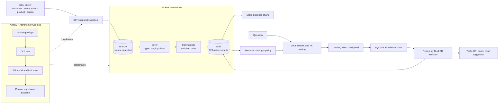

# System architecture

This repository is a modular monorepo. Each top-level package owns one responsibility while the data path stays explicit and reviewable.

## Data and control flow



Airflow controls batch work; the UI and CLI serve questions separately. DuckDB is a shared file, so the batch writer and query clients must not overlap during refresh.

## Component ownership

| Path | Responsibility |
|---|---|
| [`ingestion/`](../ingestion/README.md) | SQL Server settings, connectivity smoke check, DLT extraction, row-count reconciliation |
| [`ecom_analytics/`](../ecom_analytics/README.md) | dbt source declarations, Silver/intermediate/Gold SQL, data tests, safe profile template |
| [`text2sql/`](../text2sql/README.md) | Semantic catalog, access policy, NL routing, model adapter, SQL validation, read-only executor, CLI/UI |
| [`analytics/visualization/`](../analytics/README.md) | Read-only queries and generation of ten static Gold charts |
| [`orchestration/`](../orchestration/README.md) | Astro Runtime image, Airflow DAG, Cosmos configuration, source staging, DAG contracts |
| [`scripts/project.py`](../scripts/README.md) | Stable commands that resolve paths from the repository root |
| [`tests/`](../tests/README.md) | Python behavior, safety, path, output, and dbt-catalog contract tests |
| [`sql/`](../sql/README.md) | Read-only SQL Server profiling query; not a dbt model |
| [`docs/`](README.md) and [`reports/`](../reports/README.md) | User guides, data definitions, decisions, sanitized evidence |

## Runtime boundaries

- **Developer host:** Python 3.11 and `uv`; source credentials live in the ignored root `.env`.
- **Astro containers:** Linux Python and a separate dbt virtual environment; container credentials are read from `orchestration/.env`.
- **Analytics warehouse:** one DuckDB file at `duckdb_warehouse/warehouse.duckdb` by default. `DUCKDB_PATH` overrides it; relative paths resolve from the repository root.
- **Airflow metadata:** Astro's PostgreSQL service stores DAG/task state. It does not store analytics tables.
- **Gemini:** optional for live natural-language routing. Offline routing, SQL validation, baselines, and deterministic guardrails run without an API key.

The host and container use different environment files and filesystem paths. The runtime staging helper copies only allowlisted source and a safe dbt profile into the Astro build context.

## Repository conventions

```text
.github/workflows/        CI definitions
analytics/visualization/  static analytical outputs
docs/                     maintained project documentation
ecom_analytics/           dbt project
ingestion/                source extraction
orchestration/            Astro/Airflow runtime
reports/                  sanitized test and acceptance evidence
scripts/                  command wrappers
sql/                      source-side profiling SQL
tests/                    application tests
text2sql/                 query serving
```

Do not move a module without updating its imports, workflow path filters, Docker staging allowlist, dbt paths, and documentation links. Local data and generated state stay outside tracked source.
