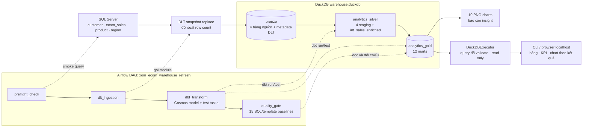
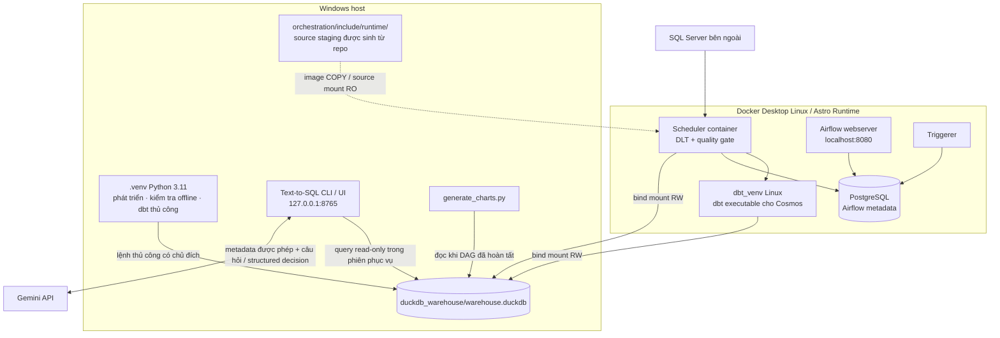

# Kiến trúc E-Commerce Analytics & Text-to-SQL

Ngày đối chiếu source: **2026-10-25**. Phase 7 đã được chủ dự án nghiệm thu. Tài liệu này mô tả kiến trúc đang có trong code; các hạng mục tổ chức và hoàn thiện tiếp theo nằm trong [kế hoạch Phase 8](phase-08-polish-and-release.md).

## 1. Kiểu kiến trúc và trách nhiệm

Project dùng một repository với các module riêng cho ingestion, transformation, analytics, serving và orchestration. Nguồn là SQL Server; DuckDB là warehouse dạng file. Đây là pipeline snapshot theo batch, được trigger thủ công qua Airflow.

| Thành phần | Trách nhiệm | Nguồn cấu hình/code |
|---|---|---|
| SQL Server | Bốn bảng nguồn, truy cập bằng tài khoản nguồn | Các biến XOM_SQLSERVER_* |
| DLT | Snapshot replace vào Bronze và đối soát row count | ingestion/ |
| dbt | 4 staging views, 1 intermediate view, 12 Gold marts và data tests | ecom_analytics/ |
| Airflow + Cosmos | Điều phối preflight → ingestion → model/test tasks → quality gate | orchestration/ |
| Text-to-SQL | Hiểu yêu cầu, áp policy, validate SQL, chạy query và định dạng kết quả | text2sql/ |
| Gemini API | Đề xuất quyết định/SQL từ câu hỏi và metadata được cho phép | text2sql/gemini.py |
| Gold visualization | Sinh 10 biểu đồ tĩnh từ Gold | analytics/visualization/ |
| PostgreSQL của Astro | Lưu DAG runs, task states và metadata Airflow | Astro local stack |

PostgreSQL của Astro và DuckDB warehouse có vai trò riêng. Số liệu nghiệp vụ nằm trong DuckDB.

### Inventory thư mục và quyết định layout

| Đường dẫn | Ownership | Trạng thái Git |
|---|---|---|
| `ingestion/`, `ecom_analytics/`, `text2sql/`, `analytics/`, `orchestration/` | Các module source theo trách nhiệm trong bảng trên | Source/config được review và commit |
| `tests/`, `orchestration/tests/` | Service tests và DAG contract tests | Test code |
| `sql/` | SQL profiling nguồn để phân tích chất lượng; không phải dbt model | Source SQL |
| `docs/`, `docs/assets/charts/` | Hướng dẫn, checkpoint và chart đã review | Documentation/evidence |
| `reports/text2sql-evaluation/` | Evaluation reports đã sanitize, giữ nguyên thời điểm chạy | Evidence lịch sử |
| `orchestration/include/runtime/` | Stage sinh bằng helper từ các source allowlist | Generated, ignored |
| `.venv/`, `.env`, local `profiles.yml`, `duckdb_warehouse/`, `logs/`, caches | Môi trường và runtime data trên máy local | Local/generated, ignored |

Quyết định giữ modular monorepo, ownership đầy đủ và các path contract được ghi tại
[ADR 0001](decisions/0001-repository-layout.md). [ADR 0002](decisions/0002-duckdb-access.md)
ghi cách host/container dùng chung DuckDB file và cửa sổ refresh/serving. Hướng dẫn
triển khai máy mới nằm trong [setup](setup.md); các thao tác thường ngày và recovery
nằm trong [operations](operations.md).

## 2. Sơ đồ luồng dữ liệu và điều phối

Đường liền biểu diễn dữ liệu hoặc phụ thuộc xử lý; đường nét đứt biểu diễn điều phối/kiểm tra.

Bronze giữ dữ liệu nguồn; staging chuẩn hóa kiểu và tên; intermediate kết hợp dữ liệu bằng left join để giữ các dòng orphan; Gold biểu diễn grain và metric phục vụ câu hỏi nghiệp vụ. Một số mart customer đọc trực tiếp staging; sơ đồ trên mô tả các tầng. Dependency chính xác của từng model được xác định bởi source()/ref() trong SQL và dbt manifest.

Bronze là output DLT được khai báo thành dbt sources. Silver và intermediate hiện cùng nằm trong schema analytics_silver; Gold nằm trong analytics_gold.

## 3. Sơ đồ môi trường chạy

Windows dùng .venv riêng. Container dùng Python Linux và dbt_venv riêng; môi trường Windows không được mount làm Python runtime cho container. Template profiles.yml.example được helper sinh thành profile container.

DuckDB path có một hợp đồng chung trong `ingestion.config.resolve_warehouse_path()`: process environment được ưu tiên, root `.env` là fallback, rồi đến path mặc định. Path tương đối luôn được neo vào repository root; container truyền path Linux tuyệt đối. Helper không cần SQL Server credentials và không tạo warehouse. `scripts/project.py` dùng cùng kết quả cho các lệnh local; dbt nhận profile tạm từ template để không phụ thuộc local profile.

| Đối tượng | Windows host | Container |
|---|---|---|
| Warehouse | <repo>/duckdb_warehouse/warehouse.duckdb | /usr/local/airflow/duckdb_warehouse/warehouse.duckdb |
| Source settings | .env ở repo root | orchestration/.env được inject |
| dbt profile | local profiles.yml, được ignore | profile sinh từ template an toàn |
| dbt executable | .venv của host | /usr/local/airflow/dbt_venv/bin/dbt |
| Source build context | module trong repo | include/runtime/ được sinh, được ignore |

Hiện mọi service trong Compose override có thể thấy warehouse qua mount RW; việc tuần tự hóa writer được thực thi ở DAG. Read-only executor là giới hạn trong application, không phải filesystem isolation của toàn bộ Astro stack.

## 4. Luồng Text-to-SQL và giới hạn truy cập

```mermaid
flowchart LR
    Question["Câu hỏi từ CLI/UI"] --> Local["Kiểm tra local<br/>PII · yêu cầu ghi/xóa · kỳ thời gian · metric mơ hồ"]
    Local -->|"refuse / clarify"| Message["Phản hồi không chạy SQL"]
    Local -->|"yêu cầu hợp lệ"| Context["Context theo trusted role<br/>catalog · metric · policy"]
    Context --> Gemini["Gemini structured output"]
    Gemini --> Decision{"action"}
    Decision -->|"refuse / clarify"| Message
    Decision -->|"SQL"| Validator["SQLGlot validator<br/>allowlist và result contract"]
    Decision -->|"template_id"| Template["Approved aggregate template"]
    Template --> Validator
    Validator --> Validated["ValidatedQuery"]
    Validated --> Executor["Executor revalidate<br/>read-only · timeout · row cap"]
    Executor --> Result["QueryResult"]
    Result --> Format["Output / deterministic chart suggestion"]
    Format --> Client["Bảng · JSON/CSV · KPI/bar/line chart"]
```

- Semantic catalog mô tả 12 Gold marts; policy hiện cho 10 relation query trực tiếp và 2 relation customer chỉ qua 3 aggregate templates.
- Trusted role đến từ cấu hình ứng dụng. Văn bản người dùng không được tự cấp quyền.
- Gemini nhận câu hỏi và semantic metadata được phép. Source credentials, raw warehouse rows và query result không được gửi theo luồng hiện tại.
- SQLGlot kiểm tra trước execution; DuckDBExecutor kiểm tra lại ValidatedQuery theo policy hiện tại.
- Policy/template và executor cùng giới hạn kết quả. Chế độ read-only không thay thế kiểm tra SQL/policy.
- Browser UI và CLI dùng cùng NaturalLanguageQueryService; chart được chọn từ kết quả có giới hạn, không cần gọi Gemini lần nữa.
- UI hiện phục vụ local và chưa có hệ thống đăng nhập/phân quyền nhiều người dùng. Policy application hiện không đủ để công bố UI ra Internet.

## 5. Quy tắc vận hành warehouse

1. Trong phiên refresh: dừng các client host đang đọc warehouse; chạy DLT, dbt, tests và quality gate tuần tự.
2. Chỉ sau khi DAG Success mới mở phiên serving hoặc sinh lại biểu đồ.
3. Trong phiên serving: query read-only; muốn refresh tiếp thì đóng các client dùng file trước.

Giới hạn này phù hợp với cách project đang dùng native DuckDB file: một process đọc/ghi, hoặc nhiều process chỉ đọc nhưng không có writer đồng thời. Airflow max_active_tasks=1 giới hạn task trong DAG, không khóa các process Windows bên ngoài. [DuckDB 1.5: concurrency](https://duckdb.org/docs/1.5/connect/concurrency)

Phase 8 ghi rõ và kiểm chứng quy tắc này. Tính năng phục vụ liên tục trong lúc refresh cần một thay đổi thiết kế riêng, chẳng hạn publish snapshot đã nghiệm thu; hiện chưa có cơ chế đó trong code.

## 6. Nguồn sự thật và bằng chứng

| Nội dung | Nguồn sự thật |
|---|---|
| Dữ liệu đầu vào | SQL Server snapshot và Bronze reconciliation |
| Logic/grain model | dbt SQL/YAML và test definitions |
| Định nghĩa metric, giả định nghiệp vụ | phase-01-data-understanding.md; semantic catalog phải được đối chiếu khi metric đổi |
| Truy cập AI được phép | access_policy.yml, semantic_catalog.yml, validator.py |
| Expected outputs | golden_set_v1.yml và checkpoint Q1–Q15 |
| Trạng thái runtime Phase 7 | phase-07-airflow-cosmos.md; phân biệt log thực tế và owner confirmation |
| Kế hoạch công việc tiếp | phase-08-polish-and-release.md; SKILL_PLAN chỉ tóm tắt và dẫn link |

Các caveat tiếp tục áp dụng: kỳ dữ liệu 2020–2023; RFM snapshot 2024-01-01; currency/gross-net chưa chốt; discount comparison không chứng minh nhân quả; taxonomy nguồn có lỗi; Q15 không có association đủ support 0,5%.

Chi tiết cây thư mục đích, danh sách cleanup và acceptance gates: [Phase 8](phase-08-polish-and-release.md).
