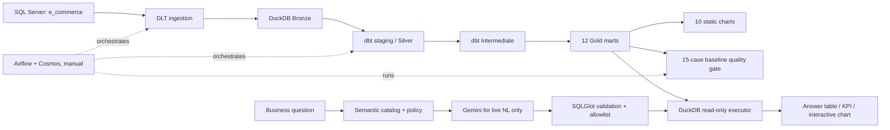
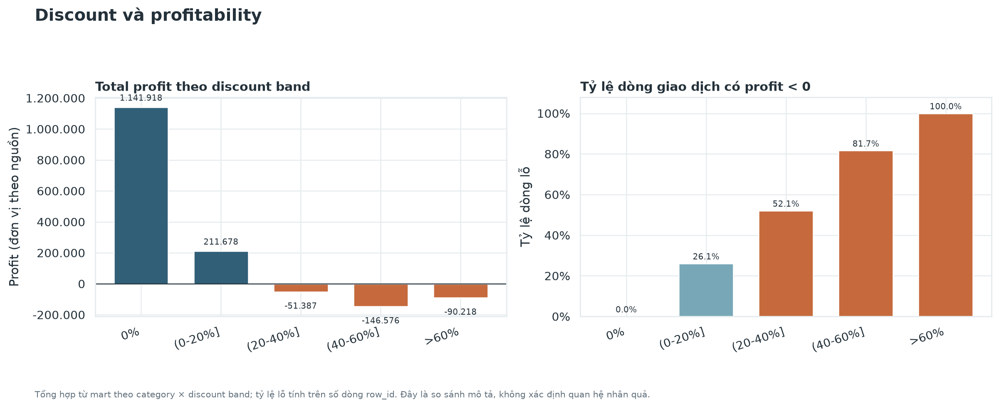
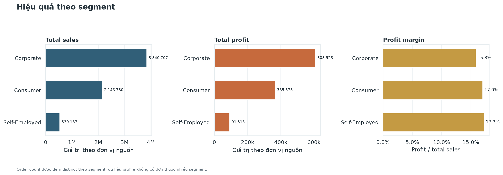

# Project walkthrough — từ nguồn dữ liệu đến quyết định kinh doanh

**Mục đích:** theo một câu hỏi từ SQL Server đến Gold mart, biểu đồ và Text-to-SQL. Walkthrough chọn **Q02 — doanh số theo segment** vì có baseline đối soát, mart, biểu đồ và demo UI offline.

**Snapshot đã nghiệm thu:** giao dịch 2020-01-01 đến 2023-12-31; 51.290 sales lines; RFM snapshot 2024-01-01. `sales` và `profit` giữ đơn vị nguồn; currency và gross/net của `sales` chưa xác nhận.

## 1. Kiến trúc trong một hình



Airflow điều phối batch refresh, không chạy Text-to-SQL serving. UI và DAG không nên dùng chung DuckDB file đồng thời khi DAG đang ghi; xem [operations runbook](operations.md).

## 2. Chuẩn bị

Từ repo root, dùng virtual environment hiện có:

```powershell
uv run --active python scripts/project.py doctor
uv run --active python scripts/project.py offline-checks
```

`offline-checks` không cần warehouse hoặc Gemini key. Để chạy Gold/chart/UI cần warehouse đã nạp. Nếu cần nạp lại từ SQL Server, cấu hình `.env` theo [setup guide](setup.md); không đưa credentials hay local database vào docs/reports.

## 3. Nguồn → Bronze → Silver → Gold

Nguồn có bốn bảng `customer`, `ecom_sales`, `product`, `region`. `ecom_sales.row_id` là grain transaction; dimension nối với fact qua customer/product/region keys. Trong snapshot đã profile có 51.290 sales lines, 17.415 customers, 28.356 products và 3.828 regions. Orphan keys được giữ bằng left join và gắn `Unknown`/unmatched, tránh làm mất sales/profit; xem [data contract](data-contract.md).

Các lệnh dưới đây kết nối nguồn và nạp snapshot, sau đó dựng dbt và so baseline:

```powershell
uv run --active python -m ingestion.check_source_connection
uv run --active python -m ingestion.run_pipeline
uv run --active python scripts/project.py dbt build
uv run --active python scripts/project.py baselines
```

Mốc tổng đối soát: 51.290 sales lines, 25.728 orders, `total_sales` 6.517.674,00 và `total_profit` 1.065.413,58. Đây là tổng bốn năm theo đơn vị nguồn, không phải doanh thu một năm. Xem [Q1–Q15 warehouse reconciliation](../reports/warehouse-reconciliation.md).

## 4. Q02 trong Gold mart

Q02 truy vấn `analytics_gold.mart_sales_by_segment`, grain một dòng mỗi segment:

```powershell
uv run --active python scripts/project.py dbt show --select mart_sales_by_segment
```

| Segment | Sales lines | Orders | Total sales | Total profit | Profit margin |
|---|---:|---:|---:|---:|---:|
| Corporate | 15.429 | 7.724 | 3.840.707 | 608.523,36 | ~15,84% |
| Consumer | 26.518 | 13.291 | 2.146.780 | 365.377,50 | ~17,02% |
| Self-Employed | 9.343 | 4.713 | 530.187 | 91.512,72 | ~17,26% |

**Diễn giải:** Corporate dẫn đầu sales/profit tuyệt đối; Consumer có nhiều đơn nhất; Self-Employed margin cao nhất nhưng sales thấp nhất. Không thể quyết định ngân sách chỉ từ những số này: thiếu chi phí acquisition/retention, và segment là giá trị trên transaction, không phải thuộc tính cố định của customer.

## 5. Gold → biểu đồ

Sinh lại bộ mười biểu đồ sau khi Gold đã được dựng:

```powershell
uv run --active python scripts/project.py charts
```

Script đọc DuckDB read-only, đối soát các tổng chính rồi ghi PNG vào `docs/assets/charts/`.

### Discount và profitability



Trong snapshot, discount bands trên 20% có tổng profit âm; band trên 60% có 100% transaction lines bị lỗ. Đây là mối liên hệ mô tả, **không chứng minh discount gây lỗ**. Hướng điều tra là phân rã theo category/product và thử nghiệm có đối chứng trước khi thay đổi chính sách. Xem [business insights](business-insights.md).

### Segment profitability



Biểu đồ giữ sales, profit và margin thành các số đo riêng để người xem phân biệt quy mô với tỷ suất. Danh sách đủ mười chart và Gold sources có tại [visualization guide](../analytics/visualization/README.md).

## 6. Text-to-SQL và kết quả

### Demo offline, không tốn Gemini quota

Khi warehouse có sẵn, chạy UI:

```powershell
uv run --active python -m text2sql.web_app
```

Mở `http://127.0.0.1:8765`, bấm **“Biểu đồ mẫu Q02 · offline”**. UI chạy baseline Q02 qua SQL validator và DuckDB executor read-only, sau đó hiển thị bảng và chart tương tác. Đây là baseline trong golden set, **không phải SQL do Gemini sinh**, và không gọi Gemini.

### Natural language qua Gemini

Khi muốn thử model, nhập câu Q02 vào UI hoặc dùng CLI:

```powershell
uv run --active python -m text2sql.cli "So sánh theo từng segment và trả các cột segment, sales_line_count, order_count, total_sales, total_profit, profit_margin; xếp giảm dần theo total_sales."
```

Lệnh này cần `GEMINI_API_KEY` trong root `.env` và dùng quota. Luồng là semantic catalog/policy xác định mart và ý nghĩa metric → Gemini đề xuất SQL → SQLGlot kiểm tra cú pháp/allowlist/policy → executor read-only thực thi với giới hạn → CLI/UI hiển thị kết quả. Chỉ Gold relations trong allowlist được query; customer-level marts bị giới hạn qua aggregate templates. Không gọi Gemini lại chỉ để xem demo offline.

## 7. Airflow/Cosmos trong luồng

DAG `ecommerce_warehouse_refresh` chạy thủ công theo bốn chặng: preflight → DLT → dbt/Cosmos models và tests → quality gate 15 baselines. DAG không gọi Gemini và không thay thế UI Text-to-SQL.

Đã ghi nhận hai lần chạy thành công với cùng nguồn và đối chiếu idempotency; khi cấu hình host nguồn sai, preflight fail và downstream không chạy; khôi phục cấu hình thì pipeline chạy lại thành công. Đây là xác nhận của chủ dự án, không phải log export; run IDs không được giữ lại. Xem [workflow acceptance evidence](../reports/orchestration/workflow-acceptance.md).

## 8. Những giới hạn cần nói khi trình bày

- Discount band cao có profit yếu/âm trong snapshot, nhưng chưa có phân tích nhân quả.
- Corporate dẫn đầu profit tuyệt đối; Self-Employed có margin cao nhất nhưng quy mô nhỏ hơn.
- RFM là heuristic ở snapshot 2024-01-01, không phải churn label hay trạng thái hiện tại.
- Market basket không có cặp đạt support chính 0,5%; các cặp ở ngưỡng thấp quá thưa để làm khuyến nghị SKU.
- Currency và ý nghĩa gross/net của source `sales` chưa được xác nhận.
- Checkpoint là bằng chứng cho snapshot này. Sau khi refresh nguồn/đổi model, chạy lại `dbt build`, baselines và chart reconciliation.
- CI workflows cần được theo dõi trên GitHub Actions sau mỗi thay đổi; cấu hình workflow trong repository không tự nó chứng minh một lần chạy đã pass.

## 9. Tài liệu tham khảo trong repo

- [Data profile và metric contract](data-contract.md)
- [Q1–Q15 reconciliation](../reports/warehouse-reconciliation.md)
- [Business insights](business-insights.md)
- [Text-to-SQL guide](../text2sql/README.md)
- [Airflow/Cosmos operations](../orchestration/README.md)
- [Setup](setup.md) · [Operations](operations.md) · [Evidence index](../reports/README.md)
