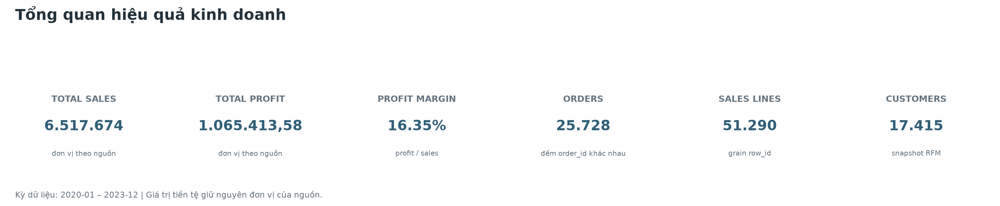
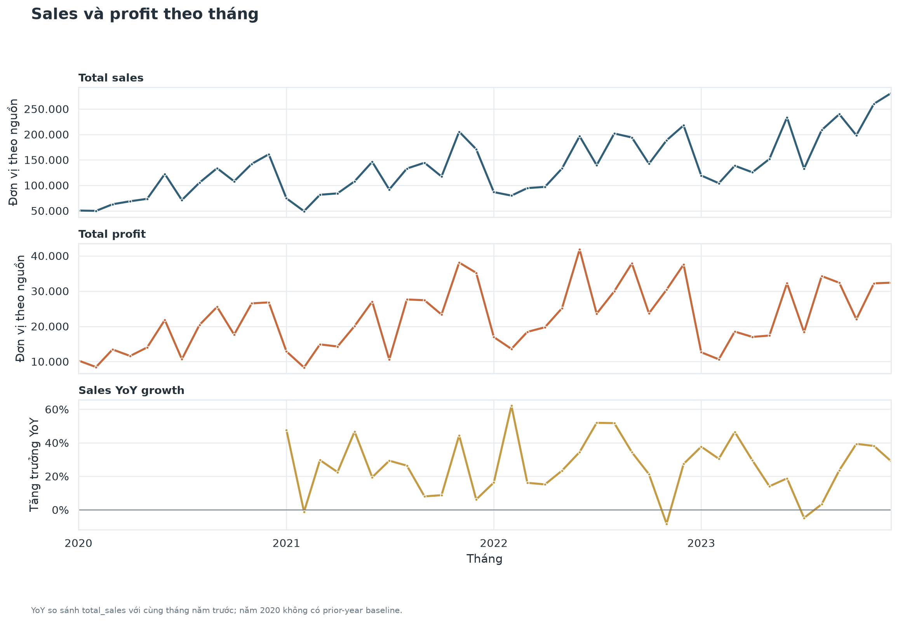

# Giai đoạn 5 — Phân tích insight kinh doanh

**Trạng thái:** Hoàn tất báo cáo insight và bộ 10 biểu đồ tái tạo được từ 12 Gold marts. Các khuyến nghị dưới đây là hướng điều tra và kiểm chứng tiếp theo, không phải kết luận nhân quả.

## Mục tiêu và phạm vi

Giai đoạn này diễn giải kết quả từ các Gold marts để trả lời các câu hỏi về discount, lợi nhuận theo phân khúc, hành vi khách hàng và market basket.

- Phạm vi giao dịch: 2020-01-01 đến 2023-12-31.
- Số dòng giao dịch: 51.290; grain là một dòng trên mỗi row_id.
- Snapshot RFM: 2024-01-01.
- Các định nghĩa metric và giả định nghiệp vụ theo [metric contract v1](phase-01-data-understanding.md#5-metric-contract-v1-và-giả-định-nghiệp-vụ).
- Nguồn chưa xác nhận sales là gross hay net revenue; tài liệu này dùng tên total_sales và không tự gắn nhãn revenue.
- Nguồn cũng chưa xác nhận đơn vị tiền tệ; các giá trị được ghi nguyên trạng, không thêm ký hiệu tiền tệ.

## Tóm tắt kết quả

| Chủ đề | Phát hiện | Ý nghĩa và giới hạn |
|---|---|---|
| Discount và profit | Các discount band trên 20% có tổng profit âm; band trên 60% có 100% dòng giao dịch bị lỗ. | Có mối liên hệ rõ trong snapshot này, nhưng chưa chứng minh discount là nguyên nhân duy nhất gây lỗ. |
| Segment profitability | Corporate có tổng profit lớn nhất; Self-Employed có profit margin cao nhất nhưng quy mô sales thấp nhất. | Cần phân biệt lợi nhuận tuyệt đối với tỷ suất lợi nhuận. |
| RFM | 2.732/3.483 VIP đạt quy tắc risk 90 ngày. | Đây là heuristic theo recency tại snapshot, không phải nhãn churn thực tế. |
| Market basket | Không có cặp SKU đạt support 0,05% trở lên; các cặp xuất hiện ở 0,01% chỉ có 3 đơn mỗi cặp. | Chưa đủ tần suất để đưa ra khuyến nghị cross-sell ở cấp SKU. |

## 1. Discount và profit

| Discount band | Dòng giao dịch | Dòng lỗ | Tỷ lệ dòng lỗ | Total sales | Total profit | Profit margin |
|---|---:|---:|---:|---:|---:|---:|
| 0% | 29.470 | 0 | 0,00% | 3.647.815 | 1.141.917,51 | 31,30% |
| (0-20%] | 10.533 | 2.747 | 26,08% | 1.396.693 | 211.677,68 | 15,16% |
| (20-40%] | 4.430 | 2.306 | 52,05% | 594.576 | -51.387,30 | -8,64% |
| (40-60%] | 4.736 | 3.867 | 81,65% | 616.105 | -146.576,11 | -23,79% |
| >60% | 2.121 | 2.121 | 100,00% | 262.485 | -90.218,20 | -34,37% |

Profit margin trong bảng được tính bằng total_profit chia cho total_sales ở từng discount band.

Kết quả cho thấy profit chuyển sang âm từ band (20-40%]. Ở band (40-60%] và >60%, tỷ lệ dòng lỗ lần lượt là 81,65% và 100%. Các dòng không discount có tổng profit dương lớn nhất, nhưng đây là so sánh mô tả giữa các nhóm giao dịch, không phải thử nghiệm có đối chứng.

**Hướng hành động:** kiểm tra thêm discount theo category, sản phẩm, giá bán và lợi nhuận trước/sau discount nếu các trường đó có sẵn. Có thể thiết kế thử nghiệm hoặc phân tích đối chứng trước khi thay đổi chính sách. Không suy ra rằng cắt discount trên toàn sàn chắc chắn làm tăng profit.

## 2. Segment profitability

| Segment | Dòng giao dịch | Số đơn | Total sales | Total profit | Profit margin |
|---|---:|---:|---:|---:|---:|
| Corporate | 15.429 | 7.724 | 3.840.707 | 608.523,36 | khoảng 15,84% |
| Consumer | 26.518 | 13.291 | 2.146.780 | 365.377,50 | khoảng 17,02% |
| Self-Employed | 9.343 | 4.713 | 530.187 | 91.512,72 | khoảng 17,26% |

Corporate đóng góp tổng profit lớn nhất và cũng có total sales lớn nhất. Self-Employed có profit margin cao nhất trong ba nhóm nhưng quy mô sales thấp nhất. Consumer có số dòng giao dịch và số đơn lớn nhất.

Các kết quả này không tự xác định segment nào nên được ưu tiên. Cần xem thêm chi phí thu hút/duy trì khách hàng, cơ cấu sản phẩm và discount trong từng segment nếu muốn ra quyết định phân bổ ngân sách.

## 3. Khách hàng và RFM

Snapshot ngày 2024-01-01 có 17.415 khách hàng; cả 17.415 đều được chấm điểm. VIP được định nghĩa trong contract v1 là monetary_score = 5, tức quintile Monetary cao nhất. Risk 90 ngày được định nghĩa là recency_days >= 90.

| Ngưỡng recency | Khách hàng VIP | Khách hàng đạt ngưỡng risk | VIP đạt ngưỡng risk |
|---:|---:|---:|---:|
| 60 ngày | 3.483 | 15.339 | 2.901 |
| 90 ngày | 3.483 | 14.660 | 2.732 |
| 180 ngày | 3.483 | 12.584 | 2.255 |

Tại ngưỡng 90 ngày, 2.732/3.483 VIP (khoảng 78,44%) đạt quy tắc risk. Ngưỡng risk 90 ngày cũng đánh dấu 14.660/17.415 khách hàng (khoảng 84,18%) trong toàn bộ population.

Tỷ lệ này cho thấy nhãn risk rất rộng trong snapshot hiện tại. Đây không phải bằng chứng rằng các khách hàng đó đã churn: dataset không có nhãn churn thực tế, và kết quả phụ thuộc vào snapshot cùng ngưỡng inactivity đã chọn.

**Hướng hành động:** xác nhận chu kỳ mua hàng bình thường và kiểm tra độ nhạy theo ngưỡng trước khi dùng nhóm này để kích hoạt chiến dịch. Nếu có dữ liệu các kỳ tiếp theo, đánh giá khả năng dự báo bằng cách so sánh với hành vi mua lại trong tương lai.

## 4. Market basket

- Có 25.728 đơn hợp lệ; 12.778 đơn có từ hai product_code khác nhau trở lên.
- Cặp product_code xuất hiện chung nhiều nhất chỉ có trong 3 đơn.
- Tại support 0,5% (tối thiểu 129 đơn), không có cặp đạt ngưỡng.
- Tại 0,1% (26 đơn) và 0,05% (13 đơn), cũng không có cặp đạt ngưỡng.
- Tại 0,01% (3 đơn), có 12 cặp không thứ tự; mỗi cặp chỉ xuất hiện trong 3 đơn.

Mart chính dùng ngưỡng support 0,5%, nên kết quả rỗng là đúng theo dữ liệu và cấu hình hiện tại. Các cặp chỉ có 3 đơn là thăm dò, chưa đủ bằng chứng cho khuyến nghị SKU cross-sell. Nếu muốn tiếp tục, có thể nghiên cứu co-occurrence ở cấp category như một phân tích riêng, ghi rõ grain và không trình bày nó như kết quả SKU-level.

## 5. Đối soát và giới hạn phân tích

- Kết quả đối soát chi tiết cho cả 15 câu hỏi được lưu tại [checkpoint Q1–Q15](checkpoint-q1-q15-reconciliation.md). Bộ 10 biểu đồ minh họa các KPI trọng tâm, không thay thế toàn bộ kết quả truy vấn cho từng câu hỏi.
- Các discount band cộng lại thành 51.290 dòng, total_sales 6.517.674 và total_profit 1.065.413,58.
- Tổng theo segment cũng đối soát về cùng total_sales và total_profit.
- 3 dòng giao dịch duy nhất không khớp product/region dimension có tổng sales 506 và profit 253; các dòng này được giữ lại trong luồng phân tích để không làm mất số liệu.
- Taxonomy category/subcategory nguồn có dấu hiệu không nhất quán; không tự sửa nhãn dựa theo tên sản phẩm.
- Phân tích discount và segment là mô tả. Không có thiết kế nhân quả/counterfactual để khẳng định một chính sách đã tạo ra thay đổi profit.
- RFM là heuristic; market basket ở ngưỡng thấp có số lần xuất hiện quá ít để dùng như bằng chứng kinh doanh mạnh.

## Khuyến nghị và bước điều tra tiếp

1. Phân rã profitability theo discount band và category/sản phẩm để tìm nơi cần xem lại chính sách, đồng thời giữ nguyên metric contract.
2. So sánh profit tuyệt đối và margin theo segment; bổ sung chi phí hoặc dữ liệu khách hàng nếu cần quyết định đầu tư.
3. Xác nhận định nghĩa churn và chu kỳ mua hàng trước khi dùng RFM risk trong vận hành.
4. Giữ kết luận market basket SKU-level ở trạng thái chưa đủ bằng chứng; chỉ mở rộng phân tích khi có thêm dữ liệu hoặc chuyển rõ ràng sang grain category.
5. Trước khi thay đổi giá/discount, xác định cách đo tác động và dùng thử nghiệm hoặc phương pháp đối chứng phù hợp.

## Cách tái tạo kết quả

Chạy từ thư mục ecom_analytics:

    uv run --active dbt show --select mart_discount_profitability
    uv run --active dbt show --select mart_sales_by_segment
    uv run --active dbt show --select mart_customer_rfm
    uv run --active dbt show --select mart_market_basket_associations

Các lệnh dbt show mặc định chỉ preview một số dòng. Các bảng tổng hợp discount, RFM và sensitivity trong tài liệu được lấy từ truy vấn tổng hợp đã chạy trên các mart tương ứng; không diễn giải preview mẫu như toàn bộ dữ liệu.

## Bộ biểu đồ Gold

Tạo lại toàn bộ biểu đồ từ thư mục gốc repository sau khi đã nạp dữ liệu và chạy `dbt build`:

```powershell
uv run --active python analytics/visualization/generate_charts.py
```

Script mở DuckDB ở chế độ read-only, xác nhận các Gold marts cần thiết tồn tại và đối soát số dòng, total sales, total profit trước khi xuất ảnh. Danh sách biểu đồ, mart nguồn và lưu ý diễn giải nằm trong [hướng dẫn visualization](../analytics/visualization/README.md); ảnh được lưu tại `docs/assets/charts/`.

### Tổng quan kinh doanh



### Discount và profitability


### Hiệu quả theo segment


### Sales và profit theo tháng


