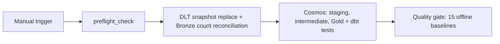

# Phase 7 — Airflow/Cosmos runtime acceptance

Ngày cập nhật: **2026-10-25**. Trạng thái: **Hoàn tất theo bằng chứng và xác nhận của chủ dự án**.

Tài liệu ghi thiết kế, cách kiểm tra và kết quả nghiệm thu của pipeline DLT → DuckDB → dbt qua Astro/Airflow/Cosmos. Run ID của lần failure-injection chưa được lưu trong checkpoint; trạng thái và kết quả dưới đây được chủ dự án xác nhận qua Airflow UI và terminal.

## A. Kết quả nghiệm thu

- Astro image build, DAG parsing, Airflow UI và import-error check đã hoàn tất thành công.
- Trong scheduler container: SQL Server smoke check thành công; `dbt debug` pass sau khi bổ sung OS package `git`; baseline offline đạt **15/15**.
- Hai lần DAG chạy với nguồn không đổi hoàn tất; chủ dự án đã đối chiếu counts/metrics và xác nhận không có sai lệch. Các mốc đối chiếu: `customer` 17.415, `ecom_sales` 51.290, `total_sales` 6.517.674,00 và `total_profit` 1.065.413,58.
- Failure recovery pass: khi host nguồn tạm thời không hợp lệ, `preflight_check` fail; `dlt_ingestion`, `dbt_transform` và `quality_gate` không chạy (`upstream_failed`). Sau khi khôi phục host, pipeline chạy thành công.
- `schedule=None` vẫn được giữ: DAG chỉ chạy khi được trigger thủ công; Phase 7 không bật lịch định kỳ.
- `orchestration/packages.txt` khai báo `git`, dependency hệ thống được dbt debug yêu cầu trong image.

## B. Thiết kế môi trường

| Môi trường | Vai trò | Cách quản lý |
|---|---|---|
| Windows + `.venv` ở repo root | Phát triển, chạy thủ công và kiểm tra offline | `uv.lock`; các lệnh Python dùng `uv run --active` khi venv đã active |
| Docker Desktop với Linux Engine | Chạy các container Astro | Docker Desktop/WSL 2; không dùng `.venv` của Windows trong container |
| Astro Runtime Python 3.11 | Airflow, Cosmos, DLT, driver SQL Server và quality gate | Dockerfile + `orchestration/requirements.txt` |
| `/usr/local/airflow/dbt_venv` trong image | dbt Core + DuckDB adapter tách dependency khỏi Airflow | Cài khi build; Cosmos dùng đường dẫn dbt cụ thể |
| SQL Server bên ngoài | Nguồn `xomdata_dataset.e_commerce` | Hostname + port + SQL authentication; module ingestion hiện có |
| DuckDB trên ổ D | Bronze, Silver và Gold | Bind mount vào `/usr/local/airflow/duckdb_warehouse` |
| PostgreSQL do Astro quản lý | Metadata của Airflow: DAG runs, task states và scheduler | Astro tự khởi tạo; không dùng làm warehouse của dự án |

`ExecutionMode.LOCAL` đã được cấu hình: dbt chạy trong container Airflow bằng executable trong venv Linux riêng, không chạy bằng Python Windows.

Mỗi môi trường có file cấu hình riêng:

- `.env` ở repo root dành cho lệnh Python trên Windows.
- `orchestration/.env` dành cho container. Các biến nguồn giữ cùng tên, nhưng `DUCKDB_PATH` phải là đường dẫn Linux trong container.
- Với code hiện có, credentials lấy từ environment. Chưa cần tạo thêm một Airflow Connection trùng thông tin trong giao diện Admin; connection đó sẽ không tự được module ingestion sử dụng.
- Phase 7 dùng baseline offline; không cần Gemini API key.

Đường dẫn được giữ thống nhất:

| Trên Windows, tương đối từ repo | Trong container | Quyền |
|---|---|---|
| `duckdb_warehouse/` | `/usr/local/airflow/duckdb_warehouse/` | Ghi bởi pipeline; đọc bởi quality gate |
| `ecom_analytics/` | `/usr/local/airflow/ecom_analytics/` | Source read-only; dbt `target/` và `logs/` là tmpfs ghi tạm trong scheduler |
| `ingestion/` | `/usr/local/airflow/ingestion/` | Đọc source |
| `text2sql/` | `/usr/local/airflow/text2sql/` | Đọc source, catalog, policy, templates và golden set |

## C. Cấu hình đã triển khai và kết quả runtime

1. **Cosmos và dbt executable — đã áp dụng.** DAG dùng `ExecutionMode.LOCAL`; `ExecutionConfig` và `RenderConfig` cùng trỏ đến `/usr/local/airflow/dbt_venv/bin/dbt`. Parser là `LoadMode.DBT_LS` và `InvocationMode.SUBPROCESS`, để Cosmos parse đúng source hiện tại qua executable cô lập thay vì dựa vào manifest cũ hoặc import dbt vào Airflow environment.
2. **Concurrency — đã áp dụng.** Giữ `schedule=None`, `catchup=False`, `max_active_runs=1`; thêm `max_active_tasks=1` và `retries=0`. `threads: 1` trong profile dbt chỉ giới hạn từng lệnh dbt; Airflow task limit mới tuần tự hóa các task model/test Cosmos. Nếu sau này có nhiều DAG dùng chung warehouse, thêm Airflow pool một slot cho mọi task chạm file.
3. **Source packaging — đã áp dụng.** Vì Astro project nằm trong thư mục con, helper `orchestration/scripts/prepare_runtime.py` sao chép allowlist source vào `orchestration/include/runtime/`; Dockerfile đóng gói staging đó ở các đường dẫn container trong bảng B. Compose dev override cũng mount staging read-only, để DAG parse và task runtime thấy cùng phiên bản source/profile. Staging bị gitignore và helper từ chối ghi đè một `include/runtime` không mang marker của helper. Helper không sao chép `.env`, `profiles.yml` local, warehouse, extracts, dbt artifacts, logs hay Python environment. Profile container được sinh từ `profiles.yml.example`.
4. **Giữ source mount chỉ đọc — đã áp dụng.** Cosmos Local operator thực thi dbt trong workspace tạm ghi được; riêng `dbt ls` của DAG parsing cần ghi dbt artifacts. Dockerfile tạo sẵn `target/` và `logs/`, còn dev Compose overlay chỉ hai thư mục này bằng tmpfs ghi tạm, giữ project source read-only. Lệnh dbt debug thủ công chuyển log sang `/tmp`.
5. **Dependency versions — đã pin và build/runtime pass.** `orchestration/requirements.txt` pin Cosmos `1.15.0` và phiên bản DLT/driver/DuckDB/YAML/SQLGlot; dbt venv pin dbt Core `1.12.5`, dbt-duckdb `1.11.0`, DuckDB `1.5.6`. OS package `git` nằm trong `packages.txt`; `dbt debug` pass trong scheduler container. `uv.lock` ở root không khóa `orchestration/requirements.txt`.
6. **Failure/retry contract — đã áp dụng.** Preflight fail-fast; DAG và từng task chưa bật retry (`retries=0`) cho tới khi recovery được chấp nhận. Quality gate không tự thay golden expectations. Astro test mẫu được thay bằng contract test của DAG (manual schedule, tuần tự hóa và graph dependencies), không tăng retries giả tạo chỉ để pass scaffold.

## D. Trình tự kết nối và kiểm tra

### D1. Kiểm tra Docker từ PowerShell trên Windows

Các lệnh Docker/Astro không yêu cầu activate `.venv`.

1. Mở Docker Desktop, đợi trạng thái Engine running. Dùng Linux containers và WSL 2 backend.
2. Trong PowerShell:

```powershell
cd "D:\E-Commerce project\ecom-analytics-text2sql"
astro version
docker version
docker info --format '{{.OSType}}'
docker context show
```

Chỉ chuyển tiếp khi `docker version` có cả Client và Server, `docker info` trả `linux` và không có lỗi pipe/daemon. Context `desktop-linux` chỉ có ý nghĩa khi Engine tương ứng đang hoạt động.

Nếu vẫn thiếu Engine:

```powershell
wsl --status
wsl --list --verbose
docker context ls
```

Đối chiếu WSL 2 và Docker Desktop Settings. Chỉ đổi sang `desktop-linux` nếu context đó thực sự tồn tại và đúng engine muốn dùng. Không mặc định xóa `.docker/buildx/.lock`, xóa dữ liệu Docker hoặc cài lại Docker vì lỗi trong shell Codex.

### D2. Kiểm tra đường mạng tới SQL Server từ host

```powershell
Resolve-DnsName db.xomdata.com
Test-NetConnection db.xomdata.com -Port 1433 -InformationLevel Quiet
```

Kỳ vọng DNS phân giải được và TCP test trả `True`. Kết quả này chỉ xác nhận đường mạng, chưa xác nhận login hoặc quyền database.

Nếu `.venv` trên host chưa active, activate một lần rồi dùng module smoke query hiện có:

```powershell
& ".\.venv\Scripts\Activate.ps1"
uv run --active python -m ingestion.check_source_connection
```

Kỳ vọng thông báo kết nối thành công, database `xomdata_dataset`, smoke query trả `1`. Nếu venv đã active, bỏ qua lệnh activate.

### D3. Thiết lập cấu hình riêng cho container

```powershell
cd "D:\E-Commerce project\ecom-analytics-text2sql\orchestration"
Test-Path .env
```

Nếu trả `False`, mới tạo từ template:

```powershell
if (-not (Test-Path .env)) {
    Copy-Item -LiteralPath .env.example -Destination .env
}
notepad .env
```

Mở file hiện có để chỉnh khi cần; không ghi đè bằng template. Điền tại máy của bạn:

```dotenv
AIRFLOW__CORE__LOAD_EXAMPLES=False
PYTHONPATH=/usr/local/airflow
DUCKDB_PATH=/usr/local/airflow/duckdb_warehouse/warehouse.duckdb
XOM_SQLSERVER_HOST=db.xomdata.com
XOM_SQLSERVER_PORT=1433
XOM_SQLSERVER_DATABASE=xomdata_dataset
XOM_SQLSERVER_SCHEMA=e_commerce
XOM_SQLSERVER_USERNAME=your_sqlserver_login
XOM_SQLSERVER_PASSWORD=your_sqlserver_password
```

Hostname và port tách riêng. Không đặt `db.xomdata.com,1433` trong biến host. Không cần thêm flag TrustServerCertificate của SSMS vào cấu hình Python; module nguồn hiện dùng pymssql và yêu cầu encryption.

Kiểm tra file profile có tồn tại và kiểm tra Git ignore, không in secrets:

```powershell
Test-Path .\include\runtime\ecom_analytics\profiles.yml
git check-ignore .env .\include\runtime ../duckdb_warehouse/warehouse.duckdb
```

Container không dùng trực tiếp `ecom_analytics/profiles.yml` của Windows. Helper staging tạo `profiles.yml` trong runtime từ template; profile này lấy DuckDB path qua `env_var('DUCKDB_PATH')` và `threads: 1`. Không ghi đè profile Windows đang dùng.

### D4. Chuẩn hóa phần C, rồi build/parse và khởi động

Đầu tiên từ repo root, refresh generated source staging; sau đó chuyển vào `orchestration/` để parse. Lặp lại lệnh staging mỗi khi source package hoặc dbt project đổi:

```powershell
cd "D:\E-Commerce project\ecom-analytics-text2sql"
uv run --active python orchestration/scripts/prepare_runtime.py
cd orchestration
astro dev parse
```

Nếu lỗi, đọc lỗi đầu tiên và xử lý theo lớp: Docker/build → dependency → missing path → profile → Cosmos import. Parse pass chưa xác nhận SQL Server kết nối được.

Trước khi start, kiểm tra cổng 8080; terminal `dbt docs serve` cũ có thể đang chiếm cổng này:

```powershell
Get-NetTCPConnection -State Listen -LocalPort 8080 -ErrorAction SilentlyContinue
```

Nếu đó là dbt docs của bạn, dừng đúng terminal đó bằng Ctrl+C. Sau đó:

```powershell
astro dev start
astro dev ps
astro dev run db check
astro dev run dags list-import-errors
astro dev run dags list
```

Kỳ vọng các service cần thiết chạy/healthy, metadata database check thành công, không có DAG import error, và danh sách có `xom_ecom_warehouse_refresh`. Mở URL và dùng thông tin đăng nhập CLI hiển thị; cổng mặc định dự kiến là 8080 cho project đầu tiên.

Nếu cần chẩn đoán:

```powershell
astro dev logs --scheduler
astro dev logs --webserver
```

Sau khi Docker lên, kiểm tra Compose thực tế qua Astro; không giả định repo phải có một `docker-compose.yml` gốc do tự viết.

### D5. Kiểm tra trong đúng container thực thi task

Từ PowerShell trong `orchestration/`:

```powershell
astro dev bash --scheduler
```

Prompt lúc này là Linux shell trong container. Chạy lần lượt:

```bash
python --version
python -m pip check
/usr/local/airflow/dbt_venv/bin/dbt --version
/usr/local/airflow/dbt_venv/bin/python -m pip check
python -c "import ingestion, text2sql, cosmos; print('Project imports: OK')"
```

Xác nhận Python 3.11, dependency không xung đột và import thành công. Tiếp theo kiểm tra các biến chỉ bằng trạng thái có/thiếu và xác nhận file warehouse tồn tại trước khi mở:

```bash
python - <<'PY'
import os
from pathlib import Path

names = (
    'XOM_SQLSERVER_HOST', 'XOM_SQLSERVER_PORT', 'XOM_SQLSERVER_DATABASE',
    'XOM_SQLSERVER_USERNAME', 'XOM_SQLSERVER_PASSWORD', 'DUCKDB_PATH',
)
for name in names:
    print(name, 'SET' if os.environ.get(name) else 'MISSING')
path = Path(os.environ['DUCKDB_PATH'])
assert path.is_file(), 'Expected mounted warehouse file is missing'
print('Mounted warehouse file: OK')
PY
```

Xác nhận network + authentication từ container:

```bash
python -m ingestion.check_source_connection
```

Host pass không thay thế cho container pass. Nếu host pass nhưng container fail, kiểm tra DNS/outbound network của Docker, các biến được inject và driver/encryption trong image. Không hạ encryption chỉ để vượt lỗi.

Kiểm tra đọc DuckDB bằng tổng số dòng, không xuất dữ liệu khách hàng:

```bash
python - <<'PY'
import os
import duckdb

with duckdb.connect(os.environ['DUCKDB_PATH'], read_only=True) as connection:
    print('Bronze sales rows:', connection.execute(
        'select count(*) from bronze.ecom_sales'
    ).fetchone()[0])
PY
```

Snapshot cũ dự kiến `51290` dòng. Nếu khác, đối soát nguồn/snapshot thay vì sửa expected values ngay.

Kiểm tra dbt kết nối đúng warehouse, ghi log chẩn đoán vào `/tmp`:

```bash
git --version
/usr/local/airflow/dbt_venv/bin/dbt --log-path /tmp/ecom-dbt-debug debug \
  --project-dir /usr/local/airflow/ecom_analytics \
  --profiles-dir /usr/local/airflow/ecom_analytics \
  --target dev
```

Kỳ vọng `All checks passed`. Sau đó chạy quality gate offline trong cùng container:

`dbt debug` cũng cần executable hệ thống `git`. Project khai báo package này trong
`orchestration/packages.txt`; khi container cũ báo `git [ERROR]`, rebuild/restart Astro image rồi
xác nhận `git --version` trước khi chạy lại `dbt debug`. Cảnh báo dbt có patch version mới hơn
không phải nguyên nhân của lỗi này, nên giữ các version đã pin để môi trường nhất quán.

```bash
python -m text2sql.evaluation.run_baselines
exit
```

Kỳ vọng 15/15 baseline; không có Gemini request. Không chạy đồng thời các kiểm tra mở warehouse với một DAG đang ghi file.

## E. Workflow và nghiệm thu



Đây là **bốn chặng logic**. `dbt_transform` là TaskGroup có nhiều model/test tasks, nên Airflow UI không chỉ có đúng bốn task instances. TaskGroup duy trì dependencies của dbt; `max_active_tasks=1` hạn chế thực thi tại mỗi thời điểm.

Trước lần chạy đầu, dừng các lệnh host đang dùng cùng file DuckDB và tạm ngừng gửi câu hỏi từ Text-to-SQL UI. Airflow refresh và local serving chưa có cơ chế điều phối truy cập file giữa hai process. DLT snapshot replace sẽ cập nhật Bronze; dbt sẽ cập nhật Silver/Gold.

1. **Chạy lần 1 — đạt.** Chủ dự án xác nhận toàn DAG và quality gate 15/15 thành công.
2. **Chạy lần 2/idempotency — đạt.** Chủ dự án xác nhận counts và business totals đối chiếu thành công khi nguồn không đổi; DLT dùng `write_disposition='replace'`, không nhân đôi Bronze.
3. **Failure recovery — đạt.** Failure injection làm `preflight_check` fail và các task downstream chuyển `upstream_failed`; sau khi khôi phục host, DAG chạy thành công.
4. **Ghi nhận acceptance — đạt.** Kết quả được ghi trong mục A và checklist dưới đây. Run ID của failure-injection không được cung cấp nên không ghi giả định.
5. **Lịch chạy — giữ thủ công.** Không thêm schedule định kỳ; việc dừng Astro sau buổi nghiệm thu là cleanup tùy chọn, không phải acceptance gate.

## F. Checklist đóng Phase 7

- [x] Docker Server/Linux Engine hoạt động trong PowerShell của người dùng.
- [x] Kết nối nguồn từ host pass.
- [x] Cosmos execution/parsing, source packaging và task concurrency đã được chuẩn hóa trong code.
- [x] Astro image build, Cosmos dependency resolution và `astro dev parse` pass.
- [x] Image build, dependency checks và DAG parse pass.
- [x] Airflow metadata DB healthy, DAG không có import error.
- [x] Container đọc được source settings và đúng file warehouse; SQL Server smoke query pass.
- [x] dbt debug và 15/15 baselines pass trong container.
- [x] Hai lần chạy DAG hoàn thành, kiểm tra idempotency pass theo xác nhận của chủ dự án.
- [x] Failure recovery pass: preflight fail-fast, downstream không chạy; sau khi restore, pipeline thành công.
- [x] README orchestration, README root và SKILL_PLAN được đồng bộ với bằng chứng runtime.

## Tài liệu kỹ thuật đối chiếu

- [Cosmos: dbt trong venv tạo sẵn và executable path](https://astronomer.github.io/astronomer-cosmos/getting_started/open-source.html)
- [Cosmos: virtualenv do Cosmos quản lý](https://astronomer.github.io/astronomer-cosmos/guides/run_dbt/airflow-worker/cosmos-managed-venv.html)
- [Cosmos Local operator: workspace tạm ghi được](https://github.com/astronomer/astronomer-cosmos/blob/main/cosmos/operators/local.py)
- [Airflow 2.10: max_active_runs và max_active_tasks](https://airflow.apache.org/docs/apache-airflow/2.10.5/configurations-ref.html#max-active-tasks-per-dag)
- [Astro: cấu hình project và environment variables](https://www.astronomer.io/docs/astro/cli/develop-project)
